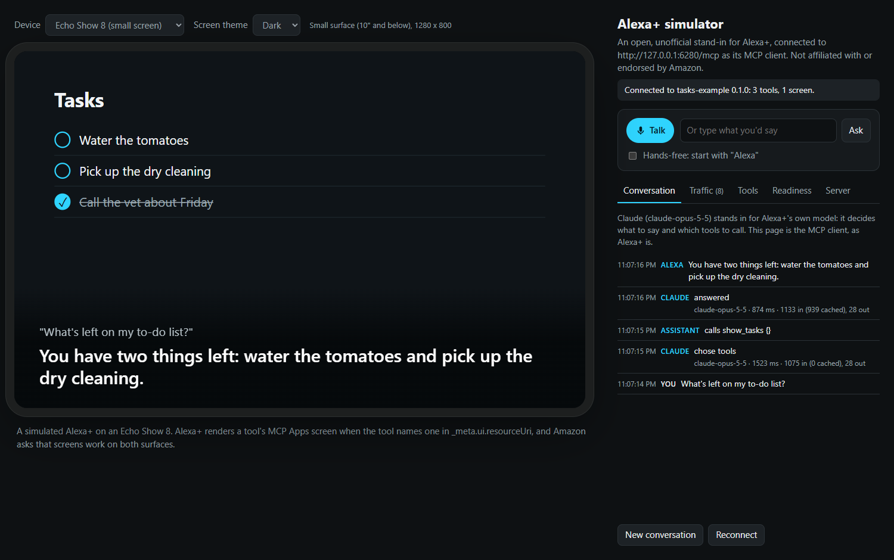
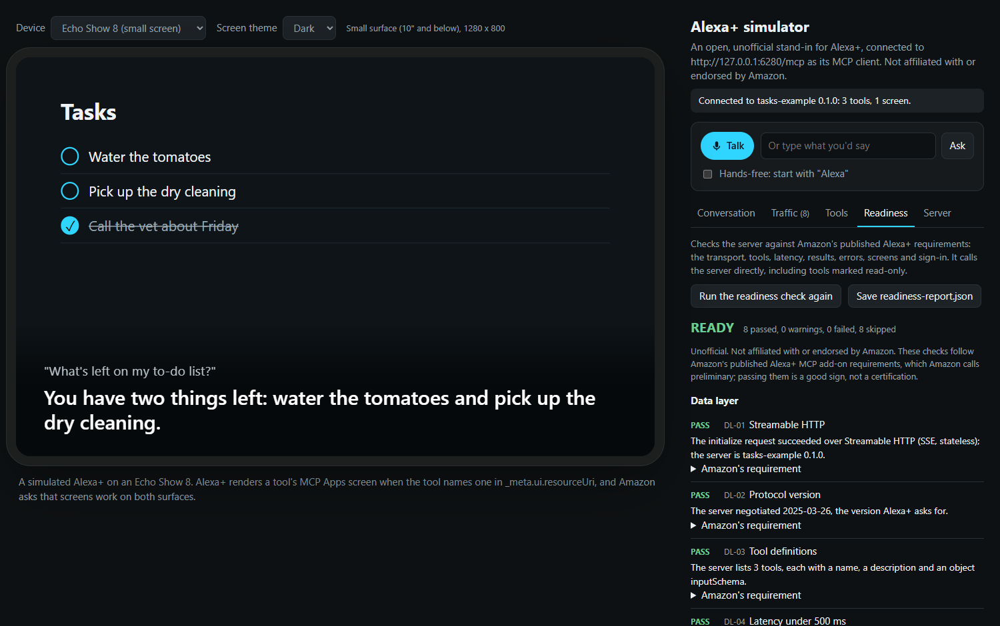
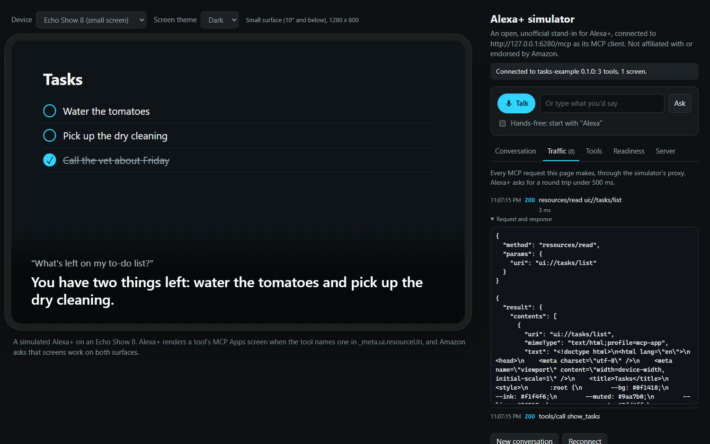
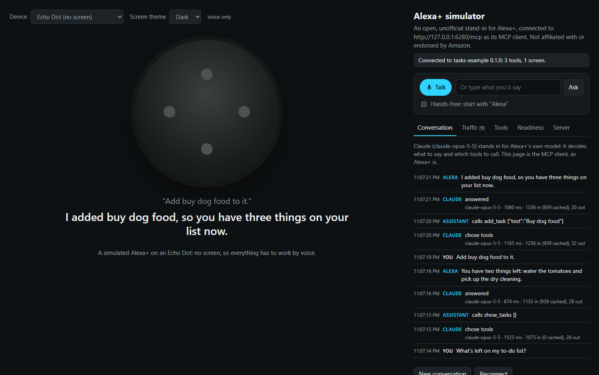
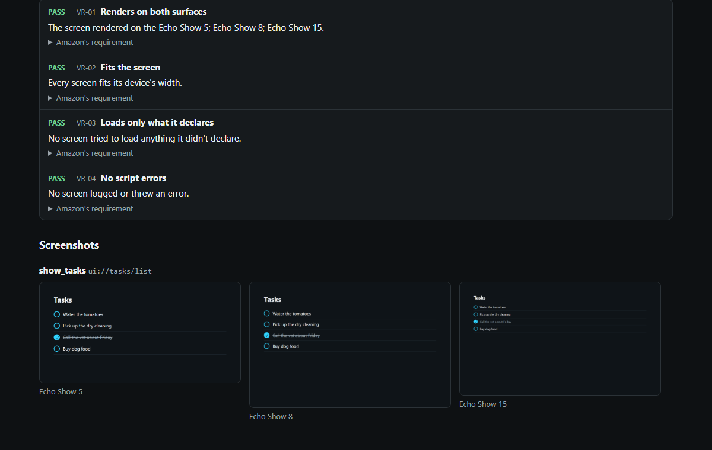

# Alexa+ simulator

An open, unofficial simulator and readiness check for Alexa+ MCP add-ons. Point it at your MCP server, talk to it on a simulated Echo Show or Echo Dot, see your MCP Apps screens at both of Alexa's screen sizes, watch every request against Alexa+'s 500 ms budget, and check the server against Amazon's published requirements.

> **Unofficial.** Not affiliated with or endorsed by Amazon. Amazon's own tools for this (a web simulator and the Local Inspector) are open to select partners for now; this follows Amazon's published documentation so anyone can build and test an add-on. Passing these checks is a good sign, not a certification. Alexa, Echo and related marks are trademarks of Amazon.com, Inc. or its affiliates.

```bash
npx alexa-plus-simulator https://your-server.example.com/mcp
```

It needs Node 22 or later. Then open http://localhost:6274. Set `ANTHROPIC_API_KEY` (or credentials for Microsoft Foundry, Amazon Bedrock, Gemini or OpenAI; see [Models](#models)) to talk to it; without any you can still call every tool by hand and run the readiness check.



| | | |
|---|---|---|
|  |  |  |
| The readiness check | Every exchange, timed against 500 ms | An Echo Dot, voice only |

## What it does

- **Simulates the device.** The page is an MCP client that connects the way Alexa+ says it does (protocol version `2025-03-26`, client `Alexa+ MCP Client`, `roots` capability), lists your tools and calls them. Pick an Echo Show 5, 8, 10, 15 or 21, or an Echo Dot with no screen at all; another device starts a new conversation.
- **Talks.** A model you choose stands in for Alexa+'s own (Claude, Amazon Nova or another Bedrock model, Microsoft Foundry, Gemini or OpenAI; see [Models](#models)): it decides what to say and which of your tools to call, and the page speaks the answer. Talk with the microphone (Chrome or Edge), turn on hands-free and start with "Alexa", or type. When it asks you a question, it listens for the answer.
- **Shows your screens.** A tool with `_meta.ui.resourceUri` gets its MCP Apps screen on the device, sized for the Small (10" and below) or Large (11" and above) surface. Screens run under the Content Security Policy their resource declares in `_meta.ui.csp`, as the MCP Apps standard has a host do, and anything the policy blocks shows up in the log with the line to add.
- **Records the traffic.** Every JSON-RPC exchange, with its timing; anything at 500 ms or more is flagged.
- **Signs in.** For a server that needs sign-in, `link` runs Alexa+'s account linking on your machine and saves the tokens, which the simulator and the check then use and refresh. See [Servers that need sign-in](#servers-that-need-sign-in).
- **Checks readiness.** The transport, protocol version, tools, latency, results, errors, screens and, for a server that needs sign-in, the account-linking setup, each tied to the published requirement it checks. From the page, or from the command line for CI:

```bash
npx alexa-plus-simulator check https://your-server.example.com/mcp --out readiness-report.json
```

It exits with 1 when something fails, so it can gate a pull request ([docs/ci.md](docs/ci.md)).

- **Renders and judges your screens.** `check --visual` shows every screen on the Echo Show 5, 8 and 15 in a headless browser, saves a screenshot of each, and checks that it renders, fits, loads only what it declares and throws no errors; `--html` writes the whole report as a page to share.



- **Checks your package.** `validate addon.json` checks an add-on package against the quickstart's schema reference: lengths, example phrases, HTTPS links, image sizes and formats. [`examples/addon.json`](examples/addon.json) passes every rule, to start yours from.

## Usage

```
alexa-plus-simulator <mcp-url> [options]       Talk to your MCP server on a simulated Echo
alexa-plus-simulator check <mcp-url> [options] Check it against Alexa+'s published requirements
alexa-plus-simulator validate <addon.json>     Check an add-on package's addon.json
alexa-plus-simulator link <mcp-url> [options]  Sign in the way Alexa+ account linking does, saving tokens for --token-file
```

| Option | |
|---|---|
| `--token <token>` | A bearer token for a server that needs sign-in (or set `MCP_TOKEN`), sent on every request |
| `--token-file <file>` | The tokens `link` saved, sent like `--token` and refreshed as they expire (not with `--token`); for `link`, where to save them (default `.alexa-plus-simulator/tokens.json`) |
| `--client-id <id>` | `link`: a client you made, with its secret, if it has one, in `ALEXA_SIM_CLIENT_SECRET` |
| `--callback-port <port>` | `link`: where the sign-in comes back, `http://127.0.0.1:<port>/callback` (default 6278) |
| `--header "Name: value"` | Another header on every request to the server, the check's included, for a server behind a gateway that wants one (repeatable) |
| `--addon <addon.json>` | Your add-on package: its example phrases become suggestions, and the check includes it |
| `--calls <calls.json>` | Sample calls for the check to make, with arguments; see [Testing tools that need arguments](#testing-tools-that-need-arguments) |
| `--extension <file.js>` | An extension for the page (repeatable); see [Extending it](#extending-it) |
| `--server-port <port>` | The proxy's port (default 6277) |
| `--client-port <port>` | The page's port (default 6274) |
| `--provider <name>` | Who stands in for Alexa+'s model: `anthropic`, `foundry`, `bedrock`, `gemini` or `openai` (default: the first with credentials, in that order); see [Models](#models) |
| `--model <id>` | The model standing in for Alexa+, or on Microsoft Foundry the deployment's name (default `claude-opus-5-5` on Anthropic and Foundry, `global.amazon.nova-2-lite-v1:0` on Bedrock, `gemini-3.8-flash` on Gemini, `gpt-6-sol` on OpenAI) |
| `--region <region>` | Bedrock's AWS Region (default `AWS_REGION`, `AWS_DEFAULT_REGION` or `us-east-1`) |
| `--foundry-api <api>` | Which API a Foundry deployment speaks, `anthropic` or `openai`, for a name that doesn't say (default: `anthropic` when the name has "claude" in it) |
| `--no-fallbacks` | Leave Anthropic's refusal fallback off, for a gateway that doesn't pass it through |
| `--open` | Open the simulator in the browser |
| `--verbose` | Log every exchange |
| `--out <file>` | `check`: also write the report as JSON |
| `--html <file>` | `check`: also write the report as a page to share, with the screenshots |
| `--visual` | `check`: show every screen on the Echo Show 5, 8 and 15 in a headless browser (Chrome, Edge or Chromium), and judge them |
| `--screenshots <dir>` | `check --visual`: where the screenshots go (default `readiness-screenshots`) |
| `--browser <name>` | `check --visual`: `chrome`, `msedge` or `chromium` (default: the first one installed) |
| `--json` | `check`, `validate`: print JSON instead of a summary |

A model's credentials in the environment turn on talking: `ANTHROPIC_API_KEY` (and `ANTHROPIC_BASE_URL` for a gateway); `ANTHROPIC_FOUNDRY_API_KEY` (or `AZURE_OPENAI_AUTH_TOKEN`) with `ANTHROPIC_FOUNDRY_RESOURCE` (or `ANTHROPIC_FOUNDRY_BASE_URL`) for Microsoft Foundry; `AWS_BEARER_TOKEN_BEDROCK`, or `AWS_ACCESS_KEY_ID` and `AWS_SECRET_ACCESS_KEY`, for Bedrock; `GEMINI_API_KEY` or `GOOGLE_API_KEY` (and `GOOGLE_GEMINI_BASE_URL` for a gateway) for Gemini; or `OPENAI_API_KEY` and `OPENAI_BASE_URL` for OpenAI or a server that speaks its API. They stay on your machine: the page asks the simulator's own server, which asks the provider.

## Models

A model stands in for Alexa+'s own: it reads the conversation, decides what to say and which of your tools to call, and the page makes the calls. Any of five providers can be that model, each through its own API, and the page is the same whichever one it is. Only Anthropic's has been tried live so far; the last note below says how the others were tested.

| `--provider` | Credentials | Default model |
|---|---|---|
| `anthropic` | `ANTHROPIC_API_KEY`, and `ANTHROPIC_BASE_URL` for a gateway | `claude-opus-5-5` at low effort, with Anthropic's refusal fallback |
| `foundry` | `ANTHROPIC_FOUNDRY_API_KEY` (the resource's key) or `AZURE_OPENAI_AUTH_TOKEN` (a Microsoft Entra ID token), with `ANTHROPIC_FOUNDRY_RESOURCE` (the resource's name) or `ANTHROPIC_FOUNDRY_BASE_URL` (its Claude endpoint, `https://<resource>.services.ai.azure.com/anthropic/`) | The `claude-opus-5-5` deployment at low effort, through Anthropic's Messages API, without the refusal fallback, which Foundry doesn't offer |
| `bedrock` | `AWS_BEARER_TOKEN_BEDROCK` (a Bedrock API key), or IAM credentials in `AWS_ACCESS_KEY_ID`, `AWS_SECRET_ACCESS_KEY` and `AWS_SESSION_TOKEN`, which sign each request | `global.amazon.nova-2-lite-v1:0`: Amazon Nova 2 Lite with its reasoning off, through the Converse API |
| `gemini` | `GEMINI_API_KEY` or `GOOGLE_API_KEY` (which wins when both are set, as in Google's own libraries), and `GOOGLE_GEMINI_BASE_URL` for a gateway | `gemini-3.8-flash` at its low thinking level, through generateContent |
| `openai` | `OPENAI_API_KEY`, and `OPENAI_BASE_URL` for another server that speaks Chat Completions, such as Azure OpenAI or a model server on your own machine (none tried yet) | `gpt-6-sol` with reasoning off, through Chat Completions |

- Without `--provider`, the simulator uses the first of these it has credentials for, in the table's order, and its startup line and the page say which. Claude comes first, through Anthropic and then through Foundry, then Bedrock (Amazon Nova): the families Alexa+ itself runs on. Gemini and OpenAI follow, OpenAI last because its base URL alone, for a local server, is the loosest sign that it's wanted.
- `--model` picks another model from the same provider: any Bedrock model that uses tools through Converse (Claude, Llama, Mistral and others, by model id, inference profile or ARN), any Gemini model with function calling, or any model a Chat Completions server has. `--region` picks Bedrock's Region; otherwise it's `AWS_REGION`, `AWS_DEFAULT_REGION` or `us-east-1`.
- On Microsoft Foundry, `--model` is a deployment's name. A Claude deployment (one with "claude" in its name) goes to the resource's Anthropic endpoint, and any other (GPT, DeepSeek, Llama, Mistral, Grok and more) to its OpenAI-compatible `/openai/v1` endpoint, with the same key. For a name that doesn't say, `--foundry-api anthropic` or `--foundry-api openai` decides. An Entra ID token works in place of the key (Microsoft's Foundry documentation shows how to get one with the Azure CLI); it lasts about an hour, so set a new one when it runs out.
- Credentials come from the environment only, not from `~/.aws` or Azure's or Google Cloud's sign-in. `aws configure export-credentials --format env` (or `--format powershell`) prints an AWS profile's as variables to set. Gemini on Vertex AI, which needs Google Cloud sign-in, isn't one of the providers; a gateway in front of it can stand in through `GOOGLE_GEMINI_BASE_URL`.
- A model that calls tools only through OpenAI's Responses API can't stand in here yet, since this speaks Chat Completions; the default, `gpt-6-sol`, calls them there with its reasoning off.
- Gemini's replies carry thought signatures that Gemini needs back with the conversation; the page passes them along with the rest of the reply.
- Microsoft Foundry, Bedrock, Gemini and OpenAI were tested against recorded API responses, in the shapes each provider documents, not live calls, since no credentials were available. If one of them misbehaves for you, please open an issue with the Traffic tab's exchange.

## The readiness rules

Each rule quotes the requirement it checks, with a link, in the report itself. On its own, the check only calls tools marked `readOnlyHint: true` that need no arguments, plus a made-up tool name to see how errors come back; it makes any other call only when you list it with `--calls`. With `--visual`, each screen runs its own scripts as it would on an Echo, so a screen that calls tools while it loads makes those calls too.

| Rule | Checks |
|---|---|
| DL-01 Streamable HTTP | `initialize` as Alexa+ sends it succeeds (a server that only speaks the legacy HTTP+SSE transport fails) |
| DL-02 Protocol version | The server negotiates `2025-03-26`, the version Alexa+ asks for |
| DL-03 Tool definitions | Every tool has a name, a description and an object `inputSchema` |
| DL-04 Latency under 500 ms | `initialize`, listing, each screen, each read-only tool and each listed call, timed; the median must be under 500 ms, and each slow request is named |
| DL-05 Tool results | Each result the check gets (from its own pick and every listed call) has text and `structuredContent`, as Amazon's documented result does |
| DL-06 Error handling | A call to a tool that doesn't exist gets a JSON-RPC error or `isError`, never a 5xx, a hang or HTML |
| DL-07 Repeated calls | The same read-only call twice returns the same result |
| DL-08 Screens | Each `_meta.ui.resourceUri`, on a tool or in a result, reads back as HTML (otherwise Alexa+ uses its data-only flow) |
| AU-01 to AU-08 | For a server that needs sign-in: 401 or 403 without a token, no `WWW-Authenticate` header, protected resource metadata at the root path, authorization server metadata whose `issuer` is that server (as RFC 8414 requires), PKCE with S256, the authorization and token endpoints, refresh tokens, and HTTPS |
| AU-09 Token refresh | With a token file from `link`: a refresh with the saved refresh token returns a new access token |
| VR-01 Renders on both surfaces | With `--visual`: every screen starts and shows something on the Echo Show 5, 8 and 15 |
| VR-02 Fits the screen | No screen runs off the side of its device |
| VR-03 Loads only what it declares | No screen loads from an origin its resource's `_meta.ui.csp` doesn't declare |
| VR-04 No script errors | No screen logs or throws an error |
| PK-01 to PK-14 | `addon.json` (with `--addon`, or `validate`): the manifest version, countries, name and description lengths, example phrases, HTTPS policy links, icon, carousel and banner sizes, the MCP integration and its HTTPS endpoint, and image formats |

## Testing tools that need arguments

The check can't guess arguments, and on its own it never calls a tool that might change something, so when every tool needs arguments, DL-05 and DL-07 are skipped. List sample calls in a file:

```json
[
  { "tool": "get_forecast", "arguments": { "city": "Denver" } },
  { "tool": "add_task", "arguments": { "text": "Bring the hose in" } }
]
```

```bash
npx alexa-plus-simulator check https://your-server.example.com/mcp --calls calls.json
```

Each listed call is made as written, even to a tool that isn't marked read-only: you chose it for your own server, so point the check at test data. Its round trip counts toward latency (DL-04), its result is judged and named (DL-05), and a screen its result names is read (DL-08). A call to a read-only tool is made twice to compare the results (DL-07); any other call is made once. A tool you don't list is still only called when it's read-only and needs no arguments, and a listed tool the server doesn't list isn't called at all. The simulator takes `--calls` too, for the check on its page.

## Servers that need sign-in

Alexa+ signs customers in to your server with account linking: the OAuth 2.1 authorization code flow with PKCE, against the authorization server your server names. `link` runs that flow on your machine, so you get a token instead of bringing one:

```bash
npx alexa-plus-simulator link https://your-server.example.com/mcp --client-id your-test-client
npx alexa-plus-simulator check https://your-server.example.com/mcp --token-file .alexa-plus-simulator/tokens.json
npx alexa-plus-simulator https://your-server.example.com/mcp --token-file .alexa-plus-simulator/tokens.json
```

`link` discovers what Alexa+ discovers: the protected resource metadata at `/.well-known/oauth-protected-resource` on your server's origin, the authorization server it names, and that server's metadata, which must list `S256` in `code_challenge_methods_supported` (Amazon blocks deployment without it, and `link` stops there too). It opens your browser to sign in, with a PKCE challenge, the `resource` parameter set to your MCP URL and the scopes your protected resource metadata lists, takes the code back at `http://127.0.0.1:6278/callback`, and saves the tokens to `.alexa-plus-simulator/tokens.json`. The folder gets a `.gitignore`, and on macOS and Linux the file is readable only by you (mode 0600). It prints the sign-in address too, in case the browser doesn't open, and gives up after five minutes; a return that isn't this sign-in's (from an old tab, say) gets an error page, and the wait goes on for its own.

With `--token-file`, the check and the simulator send the saved access token, refresh it when it's a minute from expiring or once when the server answers 401, and save rotated tokens back to the file. When the token endpoint refuses a refresh (a 4xx, like `invalid_grant`), they say to run `link` again; when it can't be reached or fails with a 5xx, they try again 30 seconds later. The check also confirms that a refresh works (AU-09), leaving out the `resource` parameter as Alexa+ does on a refresh.

Without a token, the check judges the sign-in setup but can't reach the data layer behind it, and says so: DL-01 warns that the data layer went unchecked (for a server that guards only some requests, each rule it couldn't check warns instead), so the verdict is CONDITIONAL, never READY.

**The client.** Alexa+ doesn't register itself with your authorization server ("Dynamic Client Registration (DCR) isn't supported"). You make a client id and secret for it yourself, static client registration, with every one of Alexa's redirect URIs. Make one for `link` the same way, with `http://127.0.0.1:6278/callback` as its redirect URI (or `--callback-port` and your own), then give its id with `--client-id` and its secret in `ALEXA_SIM_CLIENT_SECRET`, an environment variable so it stays out of your shell history. The token file never holds that secret, so keep it set when you check or simulate. Without `--client-id`, `link` registers a client for testing when your authorization server has a `registration_endpoint`; that's a shortcut, not what Alexa+ does.

**Why the root metadata matters.** RFC 9728, which MCP's authorization spec uses, puts the protected resource metadata for `https://your-server.example.com/mcp` at `/.well-known/oauth-protected-resource/mcp`. Amazon's account linking guide asks for it at exactly `/.well-known/oauth-protected-resource`, the root, and that's where Alexa+ reads it when you set up account linking. A server with only the path-specific document works with other MCP clients and not with Alexa+, so `link` falls back to it with a note, and the check's AU-03 fails until the root one is there.

## Extending it

Extensions add to the simulated Echo: a control in the panel, your own voice, who's speaking, a passcode, a scripted demo. An extension is a function that gets the running simulator and returns the hooks it wants. Give one to the CLI with `--extension`, or host the simulator in your own page as a library (`alexa-plus-simulator/ui`) with as many as you like:

```js
import { startSimulator } from "alexa-plus-simulator/ui";
import "alexa-plus-simulator/ui/style.css";

await startSimulator({ mcpUrl: "/mcp", modelUrl: "/api/model", check: "browser", extensions: [myExtension] });
```

[Corral for Alexa+](https://alexa-demo.corral.narralogy.ai/echo)'s hosted demo is this simulator with one extension. [docs/extensions.md](docs/extensions.md) has the hooks, the API and an example.

## For coding agents

The simulator runs a local proxy between the page and your server, shaped like the Local Inspector's, so an agent can drive and watch the same session:

| On the proxy (port 6277) | |
|---|---|
| `POST /mcp`, `GET /mcp`, `DELETE /mcp` | Forwarded to your server with the request's own headers (an extension's included), but for the connection's, the browser's (Origin, Referer, `Sec-*`) and its cookies. Send `Accept: application/json` to get plain JSON even when the server answers with Server-Sent Events. |
| `GET /events` | Server-Sent Events: `connected`, `tools-discovered`, `resource-fetched`, `widget-html`, `tool-called`, `error`, and `rpc` for every exchange |
| `GET /health` | `{"status":"ok"}` once the server has been initialized |
| `GET /state` | Everything seen this session: tools, resources, calls, errors and recent exchanges |
| `POST /api/check` | The readiness report, as JSON |

Both ports listen on 127.0.0.1 only, refuse other hosts (against DNS rebinding) and allow only the page's own origin. Your server must be `https://`, or `http://` on localhost, and the proxy follows its redirects only within its origin.

## How it differs from the real thing

- **The model isn't Alexa's.** Whichever you choose follows your server's `instructions` and tool descriptions as a capable model would, with a short spoken style; Alexa+ may choose differently.
- **The voice is your browser's.** Recognition and speech come from the Web Speech API.
- **Amazon's full rubric isn't public.** The check covers what Amazon has published (quoted, with links, in [docs/alexa-requirements.md](docs/alexa-requirements.md)) and says so in every report. The verdicts are READY, CONDITIONAL and NOT_READY, so they can't be mistaken for Amazon's certification. Amazon's inspector also judges visual, accessibility and UI quality rules it hasn't published; the screen check covers rendering, fit, declared loads and errors only.
- **It hasn't been compared with Amazon's own tools,** which are partner-only. It follows their documentation; if you have access to both and they disagree, please open an issue.
- **Sign-in runs on your machine.** `link` follows the account-linking flow the guide describes, but the sign-in comes back to `http://127.0.0.1` rather than Alexa's redirect URIs, with a client you made for testing (or one it registered), so it can't show how Amazon's own servers get on with your authorization server. It has been tested against a stand-in authorization server, not yet a production one.
- **Screens render in your browser's engine** at the documented sizes, not on Echo hardware.

## Try it without a server

```bash
git clone https://github.com/NMooreCo/alexa-plus-simulator.git
cd alexa-plus-simulator
corepack enable         # pnpm, at the version package.json names
pnpm install && pnpm build
pnpm example            # a to-do list MCP server with a screen, on port 6280
node dist/server/cli.js http://127.0.0.1:6280/mcp --open
```

`node examples/tasks/server.mjs --slow 700` makes every request slow, to see the budget warnings.

## Documentation

- [Using the check in CI](docs/ci.md): exit codes, a GitHub Actions job, and the report's format
- [Extending it](docs/extensions.md): the hooks and the API
- [Hosting it in your own page](docs/hosting.md): the library, the model route, and security
- [Troubleshooting](docs/troubleshooting.md)
- [How it fits together](docs/architecture.md)
- [Amazon's requirements, quoted](docs/alexa-requirements.md)

## Development

Node 22 or later and pnpm, which `corepack enable` sets up (on a Node without corepack, `npm install -g corepack` first). [CONTRIBUTING.md](CONTRIBUTING.md) has the rest.

```bash
corepack enable
pnpm install
pnpm check   # build, typecheck and tests
```

### Browser tests

`pnpm test:e2e` builds, starts the example server and the CLI on test ports (6374 to 6383), and drives the simulator's page with Playwright: tools, screens, devices, traffic, the readiness check, talking (to a stand-in for the Claude API, so no key is needed), an extension, the library hosted in a page of its own, and a phone's width. It uses Playwright's own Chromium (`pnpm exec playwright install chromium` downloads it once). To use Edge or Chrome as installed instead, with nothing to download, set `PW_CHANNEL`:

```bash
PW_CHANNEL=msedge pnpm test:e2e            # macOS, Linux, Git Bash
$env:PW_CHANNEL="msedge"; pnpm test:e2e    # Windows PowerShell
```

When something else holds one of those ports, move it with the variables in [test/e2e/addresses.ts](test/e2e/addresses.ts).

## License

MIT
